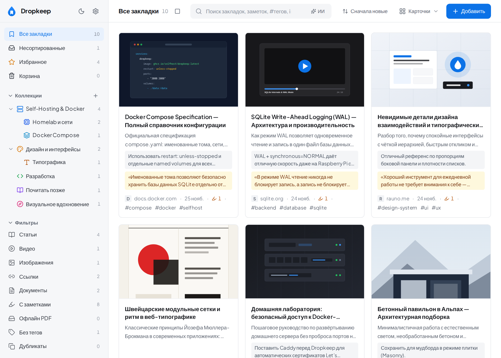
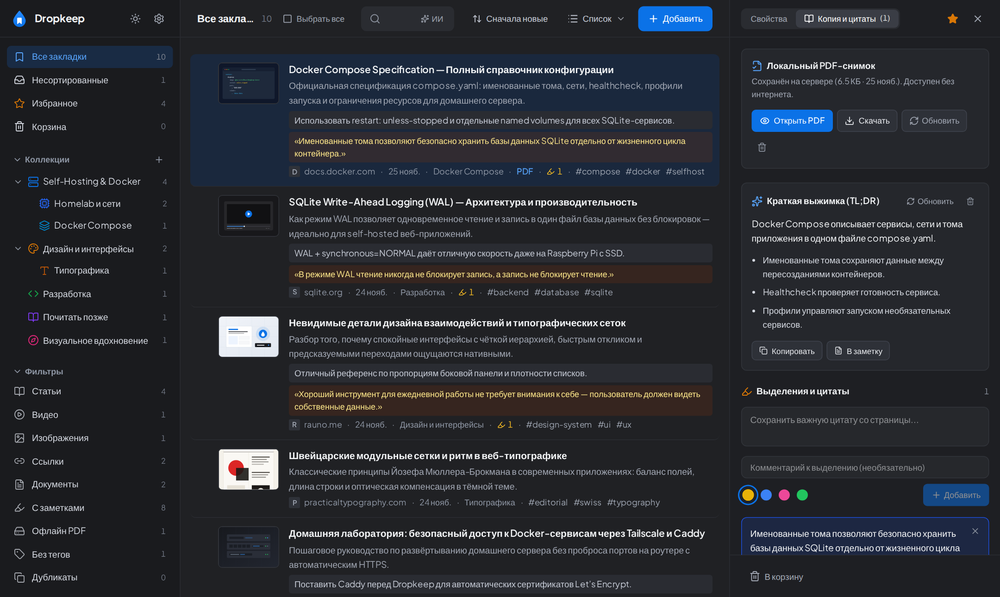
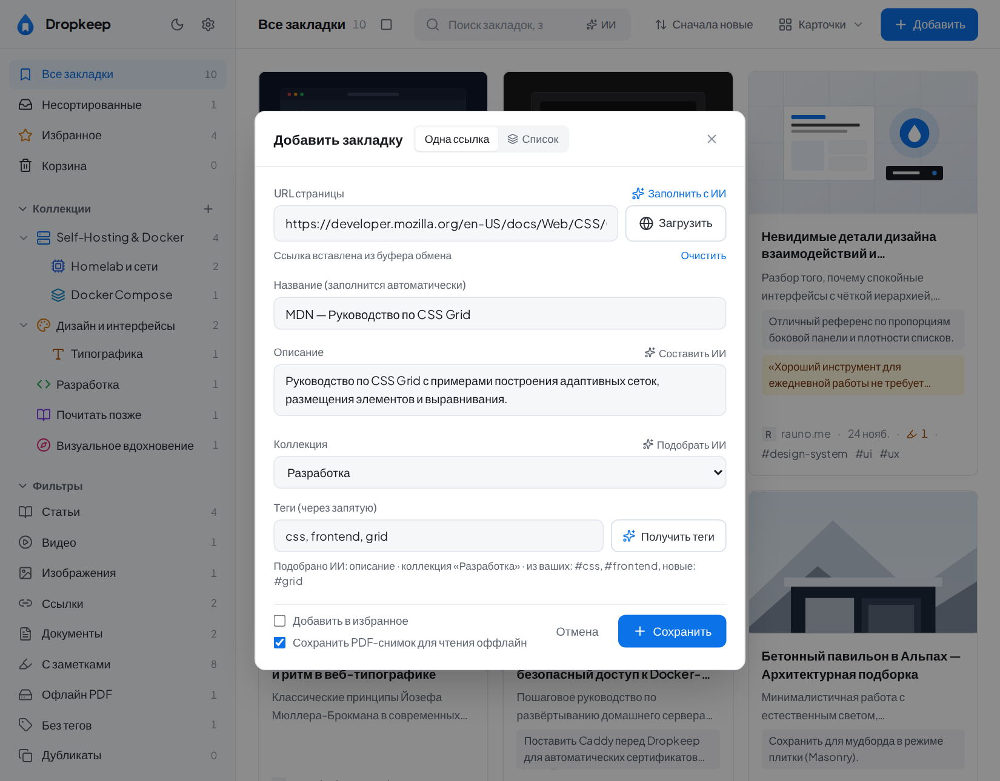

<div align="center">


<h1>Dropkeep</h1>

<p>
  <strong>Self-hosted визуальный менеджер закладок, заметок и списков задач в стиле Raindrop.io</strong><br />
  Вложенные коллекции, умные фильтры, заметки с картинками, To-Do листы с прогрессом и приоритетами, офлайн-PDF, букмарклет, локальная база SQLite и подключение собственных ИИ-моделей.
</p>


<p>
  
  
  
  
</p>

</div>

---

## Скриншоты

<table>
 <tr>
    <td width="30%"></td>
    <td width="30%"></td>
    <td width="30%"></td>
  </tr>
  <tr>
    <td align="center">Основной экран</td>
    <td align="center">Список, краткая выжимка (TL;DR) и офлайн-PDF</td>
    <td align="center">Добавление закладки</td>
  </tr>
</table>

---

## Возможности

### Закладки, организация и поиск
- **Вложенные коллекции**
- **Умные фильтры** по типу контента (статьи, видео, изображения, ссылки, документы, заметки, списки задач), избранному, цитатам, офлайн-PDF, записям без тегов и дубликатам.
- **Расширенный поиск** — поиск по заголовкам, описаниям, заметкам, пунктам задач, цитатам, тегам, доменам и сохранённому тексту страниц.
- **Массовые действия** — массовое обновление превью, переименование, удаление, перенос и тегирование.

### Заметки и списки задач (To-Do)
- **Встроенные заметки** 
- **Списки задач (To-Do)** — у каждой отдельной задачи настраиваются **прогресс выполнения в процентах** и **приоритет** .

### Быстрое добавление и букмарклет
- **Автовставка URL из буфера обмена** при открытии окна добавления ссылки (плюс кнопка вставки в один клик).
- **Браузерный букмарклет** (*Настройки → Инструменты*) — перетащите кнопку на панель закладок, скопируйте JS-код (удобно для телефона) или скачайте `.html` для импорта.
- **Пакетное добавление** — вставка сразу списка URL.

### Офлайн-копии, цитаты и обложки
- **Сохранение страниц в PDF** — встроенный просмотрщик прямо в приложении и скачивание PDF. Работает в двух режимах: лёгкий встроенный PDF-движок (статья + обложка) или полный визуальный снимок страницы через опциональный контейнер **Gotenberg (Chromium)**.
- **Скриншоты обложек** — если подключён Chromium (`GOTENBERG_URL`) и у страницы нет обложки, автоматически сохраняется лёгкий скриншот.
- **Режим чтения и выделения** — встроенный оффлайн-текст статьи, цветные цитаты и личные заметки.

### Подключение собственных ИИ-моделей (опционально)
Работает с любым OpenAI-совместимым API: **OpenAI, OpenRouter, DeepSeek, LiteLLM, Ollama, vLLM, LM Studio**.
- **Автозаполнение по запросу** — подбор 2–3 тегов (в первую очередь из уже существующих), выбор подходящей коллекции и составление краткого описания для закладок, заметок и списков задач.
- **Умный поиск по смыслу** — встроен прямо в основную строку поиска.
- **Краткая выжимка (TL;DR)** — 3–5 ключевых тезисов по странице или YouTube-ролику с кэшированием в SQLite.
- **Авто-описание YouTube-роликов по содержимому** — при сохранении ссылки на YouTube (вручную, списком или через букмарклет) Dropkeep извлекает субтитры, главы, канал и полное описание видео, а ИИ автоматически собирает краткое описание на русском прямо по сути ролика (опцию можно включать/выключать в окне добавления). Извлечённый текст видео также используется в поиске, TL;DR и офлайн-PDF.
- Если переменные ИИ не заданы, все кнопки ИИ автоматически скрываются и не перегружают интерфейс.

### Импорт, экспорт и защита доступа
- **Импорт и экспорт** в форматах **Netscape HTML** (совместим с Raindrop.io, Chrome, Firefox, Safari с сохранением дерева папок), **CSV** и полный бэкап **JSON**.
- **Опциональный мастер-пароль** — можно оставить открытым для домашней сети / Tailscale или включить защиту через интерфейс либо переменную `APP_PASSWORD`. Сессия сохраняется в защищённой `HttpOnly`-cookie до закрытия браузера.

---

## Быстрый старт (Docker)

Все данные (база SQLite, офлайн-PDF, загруженные изображения заметок и обложки) хранятся в одном Docker-томе `/data`.

### Вариант 1. Установка готового образа с GitHub (GHCR) — рекомендуется

[](https://github.com/dimap/Dropkeep/actions/workflows/docker-publish.yml)

При публикации каждого нового релиза в GitHub Actions автоматически собираются и публикуются мультиархитектурные образы (`linux/amd64` и `linux/arm64` — подходит для x86_64-серверов, Apple Silicon и Raspberry Pi).

#### Запуск через `docker compose`

Создайте файл `docker-compose.yml`:

```yaml
services:
  dropkeep:
    image: ghcr.io/dimap/dropkeep:latest
    container_name: dropkeep
    restart: unless-stopped
    ports:
      - "3000:3000"
    environment:
      - NODE_ENV=production
      - PORT=3000
      - DATA_DIR=/data
      # Опционально: защита мастер-паролем
      # - APP_PASSWORD=your-strong-password
      # - SESSION_SECRET=your-long-random-hex-secret
      # Полные PDF и скриншоты обложек через Gotenberg (удалите вместе с сервисом gotenberg ниже, если не нужен)
      - GOTENBERG_URL=http://gotenberg:3000
      # Опционально: собственный OpenAI-совместимый ИИ (умный поиск, TL;DR, теги, описание YouTube)
      # - AI_API_URL=https://openrouter.ai/api/v1
      # - AI_API_KEY=sk-...
      # - AI_MODEL=openai/gpt-4o-mini
    volumes:
      - dropkeep_data:/data

  # Chromium для полных PDF-снимков и скриншотов обложек (можно убрать, если достаточно встроенного PDF-движка)
  gotenberg:
    image: gotenberg/gotenberg:8
    container_name: dropkeep-gotenberg
    restart: unless-stopped

volumes:
  dropkeep_data:
    driver: local
```

Запустите контейнер:

```bash
docker compose up -d
```

#### Быстрый запуск одной командой (`docker run`)

```bash
docker run -d \
  --name dropkeep \
  --restart unless-stopped \
  -p 3000:3000 \
  -v dropkeep_data:/data \
  ghcr.io/dimap/dropkeep:latest
```

Приложение будет доступно по адресу `http://localhost:3000`.

#### Обновление и выбор версии

```bash
# Обновление до последнего релиза
docker compose pull && docker compose up -d
```

Можно зафиксировать конкретный релиз по тегу версии, например:
- `ghcr.io/dimap/dropkeep:latest` — последний стабильный релиз
- `ghcr.io/dimap/dropkeep:1.1.0` — точная версия релиза
- `ghcr.io/dimap/dropkeep:1.1` или `:1` — последняя версия в ветке `1.1.x` / `1.x`


### Вариант 2. Сборка из исходников

```bash
git clone https://github.com/dimap/Dropkeep.git dropkeep
cd dropkeep
cp .env.example .env

# Запуск (x86_64 / ARM64 / Raspberry Pi, вместе с Gotenberg)
docker compose up -d --build
```

---

## Переменные окружения

Настраиваются в `.env` или секции `environment` файла `docker-compose.yml`:

| Переменная | По умолчанию | Описание |
| --- | --- | --- |
| `PORT` | `3000` | Порт веб-сервера |
| `DATA_DIR` | `./data` (`/data` в Docker) | Каталог для `dropkeep.db`, `snapshots/` и `covers/` |
| `APP_PASSWORD` | *(пусто)* | Мастер-пароль для входа. Если не задан — можно оставить без пароля или установить в интерфейсе |
| `SESSION_SECRET` | *(авто)* | Секрет для подписи сессий (при отсутствии генерируется в памяти) |
| `GOTENBERG_URL` | *(пусто)* | URL контейнера Gotenberg 8 (например `http://gotenberg:3000`) для полных PDF и скриншотов обложек |
| `AI_API_URL` | *(пусто)* | Базовый URL OpenAI-совместимого API (например `https://openrouter.ai/api/v1` или `http://host.docker.internal:11434/v1`) |
| `AI_API_KEY` | *(пусто)* | API-ключ модели (не обязателен для локальной Ollama) |
| `AI_MODEL` | *(пусто)* | Идентификатор модели (например `openai/gpt-4o-mini` или `qwen2.5:7b`) |
| `APP_URL` | `http://localhost:3000` | Публичный URL вашего экземпляра Dropkeep |

---

## Локальная разработка

Требуется **Node.js 22+**.

```bash
npm install
cp .env.example .env
npm run dev
```

Команды:
- `npm run dev` — запуск Express + Vite в режиме разработки на порту `3000`
- `npm run build` — сборка фронтенда в `dist/`
- `npm run lint` — проверка типов TypeScript (`tsc --noEmit`)
- `npm start` — запуск собранного production-сервера

---

## Стек

- **Frontend:** React 19, TypeScript, Tailwind CSS v4, Vite, Lucide Icons, PDF.js
- **Backend:** Node.js 22, Express, `better-sqlite3` (WAL), Cheerio, PDFKit
- **Опционально:** Gotenberg 8 (Chromium) для полных PDF-снимков и скриншотов обложек, любой OpenAI-совместимый LLM API
