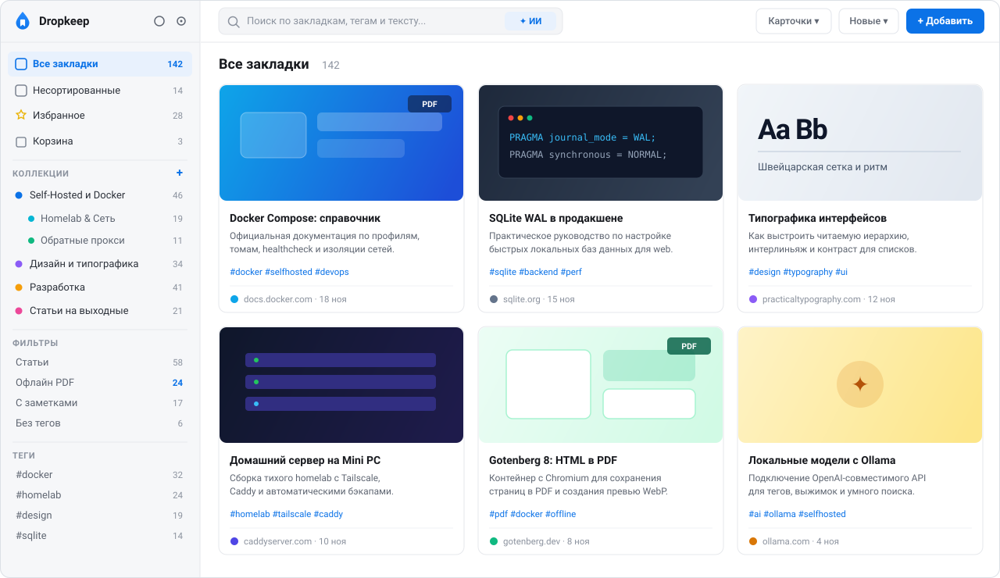
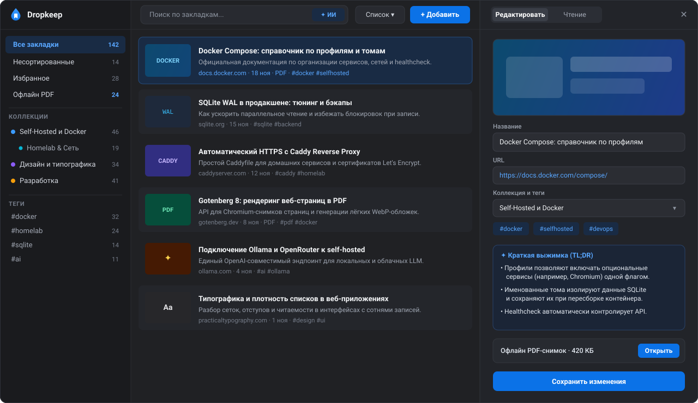
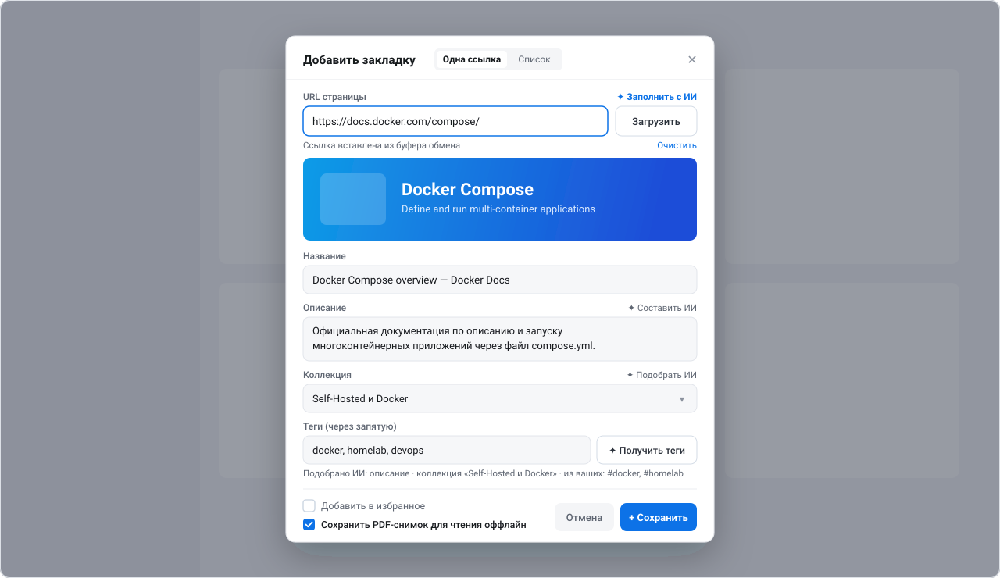

<div align="center">


<h1>Dropkeep</h1>

<p>
  <strong>Self-hosted визуальный менеджер закладок в стиле Raindrop.io</strong><br />
  Вложенные коллекции, умные фильтры, офлайн-PDF, букмарклет, локальная база SQLite и подключение собственных ИИ-моделей.
</p>

<p>
  
  
  
  
</p>

</div>

---

## Скриншоты

### Светлая тема — сетка карточек, коллекции и умные фильтры


### Тёмная тема — список, инспектор, краткая выжимка (TL;DR) и офлайн-PDF


### Быстрое добавление закладки — автовставка URL, подсказки ИИ и PDF-снимок


---

## Возможности

### Организация и быстрый доступ
- **Вложенные коллекции** с иконками, цветами и перетаскиванием закладок (Drag & Drop).
- **Умные фильтры** по типу контента (статьи, видео, изображения, ссылки, документы), заметкам и цитатам, офлайн-PDF, закладкам без тегов и дубликатам.
- **Теги и массовые действия** — переименование, удаление, перенос и тегирование выбранных закладок.
- **Привычное поведение Raindrop** — клик по закладке открывает ссылку в новой вкладке, а редактирование доступно в панели действий (и отдельной кнопкой на мобильных).

### Режимы отображения и производительность
- **4 режима просмотра** — карточки, плитка (Masonry), список и заголовки, включая полную поддержку в мобильной версии.
- **Гибкая настройка вида** — выбор числа столбцов и переключение отображаемых полей (обложка, описание, заметки, цитаты, теги, метаданные).
- **Светлая и тёмная темы**.
- **Оптимизация для больших библиотек** — порционный рендер по мере прокрутки, мемоизация карточек и подгрузка полного текста статьи только при открытии конкретной закладки.

### Быстрое добавление и букмарклет
- **Автовставка URL из буфера обмена** при открытии окна добавления закладки (плюс кнопка вставки в один клик).
- **Браузерный букмарклет** (*Настройки → Букмарклет*) — перетащите кнопку на панель закладок, скопируйте JS-код (удобно для телефона) или скачайте `.html` для импорта. Нажатие на букмарклет на любом сайте открывает Dropkeep с уже заполненным URL, заголовком и выделенным текстом.
- **Пакетное добавление** — вставка сразу списка URL.

### Офлайн-копии, цитаты и обложки
- **Сохранение страниц в PDF** — встроенный просмотрщик прямо в приложении и скачивание PDF. Работает в двух режимах: лёгкий встроенный PDF-движок (статья + обложка) или полный визуальный снимок страницы через опциональный контейнер **Gotenberg (Chromium)**.
- **Скриншоты обложек** — если подключён Chromium (`GOTENBERG_URL`) и у страницы нет обложки, автоматически сохраняется лёгкий WebP-скриншот (800×500).
- **Режим чтения и выделения** — встроенный оффлайн-текст статьи, цветные цитаты и личные заметки.

### Подключение собственных ИИ-моделей (опционально)
Работает с любым OpenAI-совместимым API: **OpenAI, OpenRouter, DeepSeek, LiteLLM, Ollama, vLLM, LM Studio**.
- **Автозаполнение по запросу** — подбор 2–3 тегов (в первую очередь из уже существующих), выбор подходящей коллекции и составление краткого описания на 1–2 предложения.
- **Умный поиск по смыслу** — встроен прямо в основную строку поиска.
- **Краткая выжимка (TL;DR)** — 3–5 тезисов по сохранённой странице с кэшированием в SQLite.
- ИИ запускается **только вручную по запросу пользователя**. Если переменные ИИ не заданы, все кнопки ИИ автоматически скрываются и не занимают место в интерфейсе.

### Импорт, экспорт и защита доступа
- **Импорт и экспорт** в форматах **Netscape HTML** (совместим с Raindrop.io, Chrome, Firefox, Safari с сохранением дерева папок), **CSV** и полный бэкап **JSON**.
- **Опциональный мастер-пароль** — можно оставить открытым для домашней сети / Tailscale или включить защиту через интерфейс либо переменную `APP_PASSWORD`. Сессия сохраняется в защищённой `HttpOnly`-cookie до закрытия браузера.

---

## Быстрый старт (Docker)

Все данные (база SQLite, офлайн-PDF и скриншоты обложек) хранятся в одном Docker-томе `/data`.

### 1. Лёгкий запуск (x86_64 / ARM64 / Raspberry Pi)
```bash
git clone <url-вашего-репозитория> dropkeep
cd dropkeep
cp .env.example .env
docker compose up -d --build
```
Приложение будет доступно по адресу `http://localhost:3000`.

### 2. Запуск с Chromium (полные визуальные PDF-снимки и скриншоты обложек)
```bash
GOTENBERG_URL=http://gotenberg:3000 docker compose --profile full-pdf up -d --build
```

---

## Переменные окружения

Настраиваются в `.env` или секции `environment` файла `docker-compose.yml`:

| Переменная | По умолчанию | Описание |
| --- | --- | --- |
| `PORT` | `3000` | Порт веб-сервера |
| `DATA_DIR` | `./data` (`/data` в Docker) | Каталог для `dropkeep.db`, `snapshots/` и `covers/` |
| `APP_PASSWORD` | *(пусто)* | Мастер-пароль для входа. Если не задан — можно оставить без пароля или установить в интерфейсе |
| `SESSION_SECRET` | *(авто)* | Секрет для подписи сессий (при отсутствии генерируется в памяти) |
| `GOTENBERG_URL` | *(пусто)* | URL контейнера Gotenberg 8 (например `http://gotenberg:3000`) для полных PDF и WebP-обложек |
| `AI_API_URL` | *(пусто)* | Базовый URL OpenAI-совместимого API (например `https://openrouter.ai/api/v1` или `http://host.docker.internal:11434/v1`) |
| `AI_API_KEY` | *(пусто)* | API-ключ модели (не обязателен для локальной Ollama) |
| `AI_MODEL` | *(пусто)* | Идентификатор модели (например `openai/gpt-4o-mini` или `qwen2.5:7b`) |
| `APP_URL` | `http://localhost:3000` | Публичный URL вашего экземпляра Dropkeep |

---

## Локальная разработка

Требуется **Node.js 22+**.

```bash
npm install
cp .env.example .env
npm run dev
```

Команды:
- `npm run dev` — запуск Express + Vite в режиме разработки на порту `3000`
- `npm run build` — сборка фронтенда в `dist/`
- `npm run lint` — проверка типов TypeScript (`tsc --noEmit`)
- `npm start` — запуск собранного production-сервера

---

## Стек

- **Frontend:** React 19, TypeScript, Tailwind CSS v4, Vite, Lucide Icons, PDF.js
- **Backend:** Node.js, Express, `better-sqlite3` (WAL), Cheerio, PDFKit, Sharp
- **Опционально:** Gotenberg 8 (Chromium) для PDF/WebP-рендеринга, любой OpenAI-совместимый LLM API
